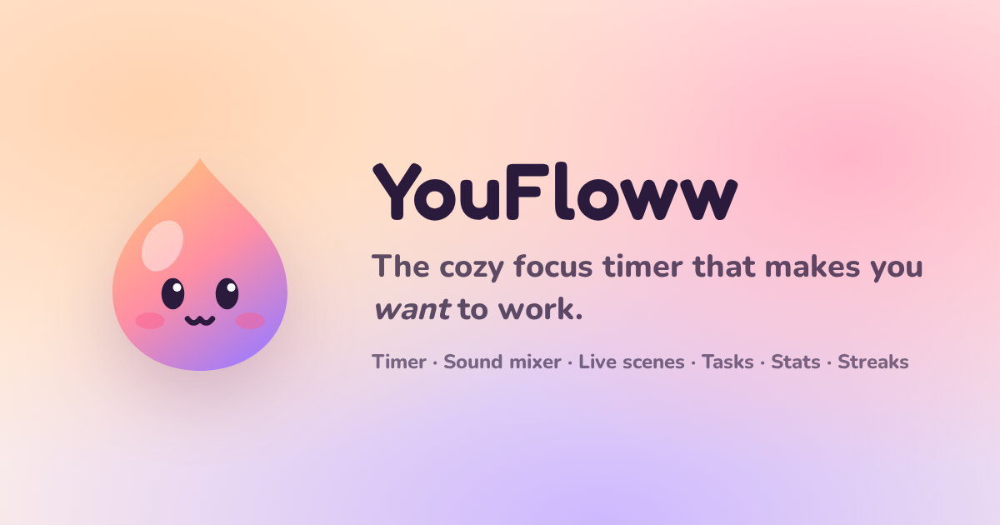

# YouFloww 🫧

**The cozy focus timer that makes you _want_ to work.** → [youfloww.vercel.app](https://youfloww.vercel.app/)



YouFloww is a free, no-sign-up focus space: a Pomodoro-style timer with a cute companion, a layered ambient sound
mixer, living backgrounds, tasks, a journal, a weekly planner, deep stats, streaks and live leaderboards.

## What's inside (v3)

| | |
|---|---|
| 🫧 **Flowy** | An animated mascot that reacts to your timer (headphones while focusing, sleepy on breaks, cheering when you finish) with eyes that follow your cursor. Poke it for study tips. |
| ⏱️ **Liquid orb timer** | Timestamp-based and Web-Worker-ticked, so it stays accurate in background tabs and **survives page refreshes**. Focus / short / long cycles, ±5 min, auto-start, task-linked sessions. |
| 🎧 **Sound mixer** | Rain, forest, café, fireplace, crickets, cat purr, lo-fi vinyl + generated brown/pink/white noise and 40Hz binaural focus beats. Layer them, save presets, upload your own music, or play any YouTube link in a floating player. |
| 🌈 **Scenes** | 7 themes, a WebGL aurora that shifts colour with each mode, YouTube live wallpapers, your own image/video, and snow / rain / sakura / fireflies / stars / bubbles particles. |
| 📝 **Tasks** | Natural language: `Essay 45m #school !` → 45-minute estimate, category, priority. Subtasks, drag to reorder, focus a task to log time against it, undo. |
| 📈 **Stats** | Daily goal ring, 7/30-day bars, a GitHub-style *focus garden*, power hours, time per category, session ratings and a shareable **Floww Wrap** story image. |
| 📔 **Journal & 🗓️ Planner** | Mood + prompt-driven journal with autosave and search; a weekly time-block planner with a live "now" indicator. |
| 🏆 **Community** | Live "flowing now" count, today's focus leaderboard and alive-streak leaderboard. |
| 🏅 **Badges** | 18 achievements across four rarities. |
| ⌨️ **Power-user friendly** | `⌘K` command menu, single-key shortcuts (`?` lists them), Zen mode, and a **pop-out timer** using Document Picture-in-Picture. |
| 😂 **Meme mode** | The YouFloww classic: a random meme sound when you finish, a sad one if you quit early. Or pick cute synthesized chimes. |
| 👀 **Presence guard** | Optional on-device camera detection that auto-pauses when you walk away. Nothing is uploaded. |

Works offline as an installable PWA. Sign-in (Google or email) is optional; it syncs across devices in real time,
and guest progress moves into your account when you sign up.

## Tech

- **Vite + React 19 + TypeScript**, Tailwind CSS v4 design tokens, Motion for animation, Zustand for state
- **Firebase** (Auth + Firestore with a persistent multi-tab cache), lazy-loaded after first paint
- Web Audio API (synth SFX, noise generators, mixer with limiter), WebGL shader background, Canvas particles,
  Web Workers, Screen Wake Lock, Document Picture-in-Picture, View Transitions, Notifications, Web Share
- Code-split panels, self-hosted variable fonts, Workbox service worker

Data stays compatible with v2: the same `users/{uid}`, `publicUsers/{uid}` and `presence` collections, and the same
`youfloww_guest` localStorage key, so existing streaks and stats carry over.

## Develop

```bash
npm install
npm run dev        # http://localhost:5173
npm run build      # typecheck + production build into dist/
npm run preview
```

Vercel picks up `vercel.json` automatically (build `npm run build`, output `dist`).

### Firestore

Rules and indexes live in `firestore.rules` / `firestore.indexes.json`. Deploy the index for a faster leaderboard
query (the app falls back to the v2 query if it's missing):

```bash
firebase deploy --only firestore:indexes
```

## Project layout

```
src/
  audio/        sfx synth + ambient mixer
  data/         user data model, session accounting (v2 compatible)
  services/     firebase (lazy), sync, presence, leaderboards
  store/        zustand stores: data, timer, prefs, ui
  features/     timer, mascot, scene, tasks, sounds, stats, journal, planner,
                community, achievements, settings, auth, shell (dock, palette), pip
  ui/           primitives + sheet/dialog
legacy/         the previous vanilla-JS version, kept for reference
```
